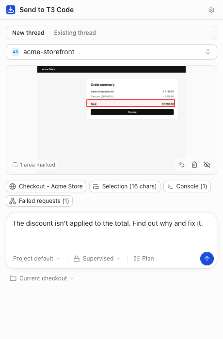
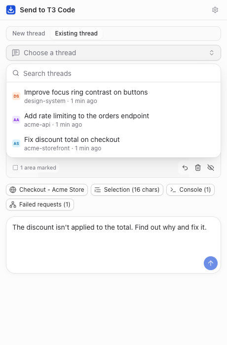
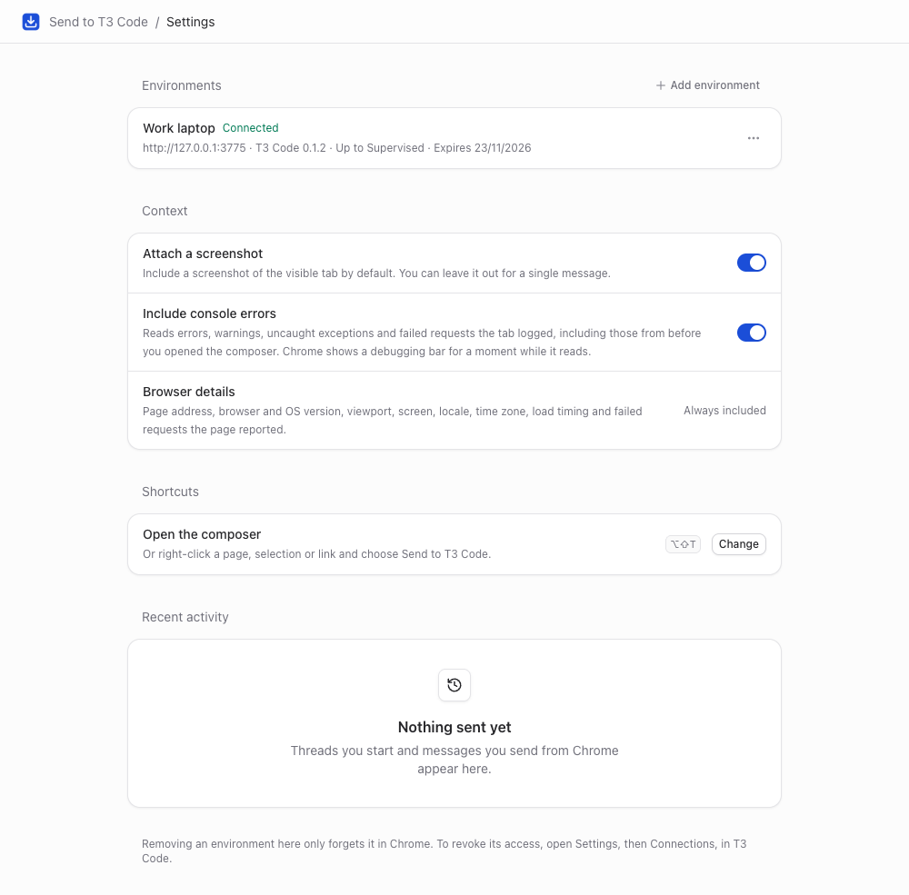

# Send to T3 Code (unofficial)

A Chrome extension that sends what you are looking at to [T3 Code](https://t3.codes). It can start a new agent thread or add to an existing one, in any T3 Code environment you have connected. Each message carries a screenshot, the page context and browser details, and can include console errors.

> **Status:** early and unofficial. This is a personal project, not affiliated with or endorsed by T3 Tools Inc. It depends on T3 Code's MCP tools and OAuth endpoints, which T3 Code does not document as a stable API. It was last tested with T3 Code 0.1.2 and Chromium 156. It is not on the Chrome Web Store; install it from a release or from source.

<p>
  
  
</p>

Use it to:

- Hand a Slack message from your team to an agent straight away.
- Report a bug you just saw in a web app. The message can include a marked-up screenshot, console errors, failed requests and browser details.
- Add what you are looking at to a thread an agent is already working on.

## How it works

The extension connects to each T3 Code environment's MCP server (`http://127.0.0.1:3773` for the desktop app) as an approved MCP client. When you send:

1. It captures the visible tab and reads the page context. It then reads the tab's console history, unless you turned that off.
2. It uploads the screenshot with `t3_attachment_prepare_upload`.
3. It sends with one of:
   - `t3_thread_launch` for a new thread.
   - `t3_thread_send` for an existing thread.
   - `t3_thread_send_attachments` for an existing thread when a screenshot is attached.

What it sends; you can switch each item off before sending:

| Context | When it is available |
| --- | --- |
| Screenshot of the visible tab, with red outlines you drag on it | Any normal web page |
| Page title, address and description | Any normal web page |
| Browser and OS version, viewport, screen, color scheme, locale, time zone, page load timing, referrer | Any normal web page |
| Failed requests (HTTP 400 and above) | Any normal web page, from Resource Timing. With console access, it also includes network errors and cross-origin failures. |
| Console errors and warnings, uncaught exceptions, unhandled rejections, with stack locations | When console reading is on (the default; see below), including messages logged before you opened the composer |
| Selected text | When you selected text |
| Slack message with sender, time, permalink and thread replies | On `app.slack.com`, from the message you right-clicked or have selected |
| The link you right-clicked | When you used the context menu on a link |

## Install

Requires Chrome 127 or later.

**From a release:** download `send-to-t3-code-vX.Y.Z.zip` from the [releases page](https://github.com/tiaanduplessis/t3-code-extension/releases), and unzip it.

**From source:** requires Node 24 and pnpm.

```sh
pnpm install
pnpm build
```

Then load it:

1. Open `chrome://extensions` and turn on **Developer mode**.
2. Click **Load unpacked** and choose the unzipped release folder, or `dist` when building from source.
3. Pin **Send to T3 Code (unofficial)** to the toolbar.

## Connect T3 Code



1. Open the extension's settings. Right-click the toolbar icon and choose **Options**, or use the gear in the popup.
2. Create a pairing code in T3 Code under **Settings > Connections**. Or run this in a terminal:

   ```sh
   t3 auth pairing create
   ```

   A code limited with `--scope orchestration:read --scope orchestration:operate` can approve up to **Auto** but not **Full access**. A code is used up even when approval fails.

3. Paste the code or pairing link and choose the highest access level the extension may use. T3 Code enforces this level.
4. Click **Connect**.

Repeat with **Add environment** for each T3 Code environment you use, such as a server on another machine in your tailnet. A pairing link includes the server address. Chrome asks for permission to reach addresses other than `127.0.0.1` and `localhost`. If two environments share a name, the extension adds the address to tell them apart.

Each connection lasts 30 days. The popup reminds you when one is about to expire. To revoke access before then, remove the connection under **Settings > Connections** in T3 Code.

### Choosing an access level

The level you approve when connecting matters in two ways:

- **New threads** can use that level or a lower one. The composer starts at **Supervised**, then remembers your last choice.
- **Existing threads** can only receive messages if they run at or below that level. T3 Code refuses the rest. If your threads usually run with **Full access**, connect with **Full access** so you can send to them. The picker shows the threads you can't send to, with the reason.

Captured context can include text other people wrote, such as a web page or a Slack message. The message tells the agent to treat that context as information, not instructions. Even so, think before sending it to a thread with **Full access**.

### Console access

**Include console errors** is on by default and can be turned off in settings. The extension reads the tab's console history through Chrome's debugger API:

- **Earlier messages are included.** When the debugger attaches, Chrome replays the errors, warnings and failed requests the tab has already logged. Nothing needs to be set up beforehand, and you don't need to reload the page.
- **Chrome shows a debugging bar briefly.** The bar reads "Send to T3 Code (unofficial) started debugging this browser" and appears for under a second while the console is read. The screenshot is taken before the bar appears.
- **Chrome requires the `debugger` permission at install.** It can't be an optional permission. Loaded unpacked, Chrome shows no prompt for it.
- **Some pages can't be read.** Chrome does not allow it on `chrome://` pages or the Chrome Web Store, and some pages refuse a second debugger, for example when DevTools is attached in a particular way. On those pages, the message goes without console information.

## Use it

- **Toolbar button or <kbd>Alt+Shift+T</kbd>.** Opens the composer for the current tab. You can change the shortcut at `chrome://extensions/shortcuts`.
- **Right-click > Send to T3 Code.** Works on a page, a selection, a link or an image. On Slack, right-click the message you want to send.

In the composer:

1. **New thread or Existing thread.**
   - **New thread:** pick a project. The list covers all your environments, grouped by environment.
   - **Existing thread:** pick one of your recent active threads in any environment. Threads show their project, status and age.
   The extension remembers your last choice for each site.
2. **Screenshot.** Drag on it to outline what you mean. Use the eye button to leave it out.
3. **Context.** Click a chip to include it or leave it out.
4. **Message.** Write the task. <kbd>Enter</kbd> sends and <kbd>Shift+Enter</kbd> adds a line.
5. **For a new thread,** also choose the model and reasoning effort, **Plan** mode, the access level, and the workspace: **Current checkout**, **New worktree** from a base branch, or an existing worktree.
6. **For an existing thread that is working,** choose **Queue** (send after the current turn) or **Steer** (join the turn in progress). T3 Code can't queue a message that has a screenshot, so a screenshot always joins the current turn. Leave the screenshot out to queue.

If you close the popup while sending, the work continues, and Chrome shows a notification when it is done.

## Privacy

- **Where data goes.** Captured data goes only to the T3 Code servers you connect, and only when you send. The extension has no analytics or telemetry and contacts no other service.
- **What is stored in Chrome.** Connection tokens, preferences, drafts and recent activity are kept in `chrome.storage` in your browser profile.
- **What is read from a page, and when.** Page content, the console and Slack messages are read only when you open the composer or use the context menu. The Slack content script on `app.slack.com` only remembers which message you last right-clicked or hovered.
- **What reaches the agent.** Anything you send goes to the agent and model provider configured in T3 Code. Leave out the screenshot or context chips that contain anything you don't want to share.

## Permissions

| Permission | Why |
| --- | --- |
| `activeTab`, `scripting` | Capture the tab you invoke the extension on and read its context |
| `contextMenus` | The Send to T3 Code menu item |
| `storage` | Connections, preferences, drafts and recent activity |
| `notifications` | Tell you when sending finished after the popup closed |
| `declarativeNetRequestWithHostAccess` | Remove the `Origin` header from the extension's own requests to T3 Code's `/mcp` endpoint (see below) |
| `debugger` | Read the tab's console history while **Include console errors** is on |
| Host access to `127.0.0.1` and `localhost` | Reach a local T3 Code server |
| Content script on `app.slack.com` | Remember which Slack message you right-clicked |
| Optional host access, per server | T3 Code servers on other hosts |

### Why the extension removes the Origin header

T3 Code's `/mcp` endpoint rejects any request that carries an `Origin` header, even with a valid token. This keeps web pages from driving it. Chrome adds `Origin` to every POST an extension makes, so the extension adds a `declarativeNetRequest` rule that removes the header. The rule only applies when both of these are true:

- the extension itself made the request (`initiatorDomains` is the extension's ID).
- the request goes to `<connected origin>/mcp`.

Requests from web pages keep their `Origin` header, and T3 Code still rejects them. The end-to-end test checks this with a valid token. If T3 Code starts accepting `chrome-extension://` origins, the rule can be removed.

## Releasing

1. Update the version in both `package.json` and `public/manifest.json`. The build fails if they differ.
2. Move the changes under a `## X.Y.Z - YYYY-MM-DD` heading in `CHANGELOG.md`.
3. Commit, then tag and push: `git tag vX.Y.Z && git push origin vX.Y.Z`.

The release workflow checks that the tag matches `package.json`, runs the checks, and attaches `send-to-t3-code-vX.Y.Z.zip` to a GitHub Release, using that version's changelog section as the notes.

## Development

```sh
pnpm dev             # rebuild dist/ on change; reload the extension in chrome://extensions
pnpm typecheck
pnpm test            # unit tests (vitest)
pnpm build           # production build, then checks the injected capture function
pnpm check:contract  # check the live T3 Code server contract (needs T3 Code running)
node scripts/mcp-call.mjs <tool> '<json args>'   # call T3 Code MCP tools the way the extension does
```

The browser scripts need Playwright's Chromium: `pnpm exec playwright install chromium`.

### Contract check

`scripts/contract-check.mjs` mints a short-lived pairing code with the `t3` CLI. It then goes through discovery, client registration, approval, token exchange and the MCP tool list. It revokes its session when it finishes. Pass `--launch` to also start a scratch thread with an image attached.

### MCP call helper

`scripts/mcp-call.mjs` pairs, runs the tool calls you pass and revokes its session. Settings:

- `T3_ORIGIN` and `T3_BASE_DIR` point it at another server.
- `T3_ACCESS=full-access` approves it with full access. Project changes need this.

### README screenshots

`scripts/readme-screenshots.mjs` regenerates `docs/images/` from a demo T3 Code server with made-up projects. The setup steps are at the top of the script.

### Slack check

`scripts/slack-check.mjs` serves made-up Slack markup to the built extension. It right-clicks a message and checks that the composer picks it up. It does not contact T3 Code.

### End-to-end test

`scripts/e2e.mjs` loads the built extension into Playwright's Chromium and runs the whole flow:

1. Pairs one or two environments.
2. Opens a local test page that logs errors and has a failing request. It then checks that the composer reads the console history the page logged before the composer opened.
3. Starts a new thread in the project you name, then sends a follow-up with a screenshot to that same thread.
4. Checks that a web page still gets 403 from `/mcp`.

**Use a throwaway project.** The threads run with Supervised access and are asked not to change files. Screenshots go to `e2e-output/`.

The test's copy of the manifest gets `<all_urls>`, because automation cannot click the toolbar button that grants `activeTab`.

To test across environments, start a second server and register a project there:

```sh
t3 serve --base-dir /tmp/t3-env2 --port 3774 --no-browser
T3_ORIGIN=http://127.0.0.1:3774 T3_BASE_DIR=/tmp/t3-env2 T3_ACCESS=full-access \
  node scripts/mcp-call.mjs t3_project_create '{"title":"env2 test","workspaceRoot":"/tmp/env2-repo"}'
node scripts/e2e.mjs --project "<throwaway>" \
  --second-origin http://127.0.0.1:3774 --second-base-dir /tmp/t3-env2 --second-project "env2 test"
```

### Layout

| Path | Contents |
| --- | --- |
| `src/background/` | Service worker: dispatch pipeline, console reader, context menu, Origin rule |
| `src/popup/` | Composer UI |
| `src/options/` | Settings page: connections, console access, history |
| `src/lib/` | MCP client, OAuth pairing flow, T3 Code tool wrappers, prompt builder, model and target rules |
| `src/capture/` | The function injected with `executeScript`; it must stay self-contained |
| `src/content/` | Slack content script |
| `src/ui/` | Components styled after T3 Code's coss-ui components and default theme |

### Notes on the T3 Code API

The extension relies on T3 Code's MCP tools and OAuth endpoints. T3 Code is in beta and does not document these as a stable API. `pnpm check:contract` is the quickest way to see whether a T3 Code update changed anything the extension depends on.

- **Recent threads.** Outside clients can only list threads per project. The extension asks each project for its latest active threads, up to six projects at a time. The list is cached for the browser session.
- **Branches and worktrees.** These come from `t3_worktree_list`, which needs a thread, so the extension uses the project's most recent thread. For a project with no threads, it asks you to type the base branch.
- **Opening a thread.** Threads appear in the T3 Code app's thread list. **Open in T3 Code's web app** opens a thread in the web UI on the same server. A browser that is not paired with T3 Code sees a pairing screen instead. The desktop app has no link that opens a specific thread.

## Acknowledgements

The UI adapts T3 Code's design tokens and component styles. T3 Code is MIT licensed; see [THIRD_PARTY_NOTICES.md](THIRD_PARTY_NOTICES.md).

## License

[MIT](LICENSE)
